# Cours de rappel : concurrence en Java

> Multithreading classique et virtual threads. Un rappel pour se remettre dans le bain avant la formation, dans l'ordre d'`Objectif.txt`.

## Introduction

Un programme concurrent fait avancer plusieurs tâches en même temps. En Java, l'unité d'exécution est le **thread**. Pendant 25 ans, un thread Java correspondait à un thread du système d'exploitation : puissant mais coûteux (environ 1 Mo de pile réservée, création et changement de contexte gérés par l'OS). On travaillait donc avec un nombre limité de threads, regroupés en **pools**.

Depuis Java 21, les **virtual threads** changent la donne : ils sont gérés par la JVM, coûtent quelques centaines d'octets, et on peut en créer des millions. Les problèmes de fond (partage de données, synchronisation) restent les mêmes. Il faut donc maîtriser la première partie pour bien utiliser la seconde.

**Sommaire**

- Partie 1 : multithreading
  1. [Thread et processus](#1-thread-et-processus)
  2. [Race condition et deadlock](#2-race-condition-et-deadlock)
  3. [Synchronisation](#3-synchronisation)
  4. [Pool de threads et ExecutorService](#4-pool-de-threads-et-executorservice)
  5. [Collections thread-safe](#5-collections-thread-safe)
  6. [Producteur / consommateur](#6-producteur--consommateur)
  7. [Lecteurs / rédacteurs](#7-lecteurs--rédacteurs-readerwriter)
- Partie 2 : virtual threads
  1. [Principes fondateurs](#8-principes-fondateurs)
  2. [API de création](#9-api-de-création)
  3. [Structured Concurrency](#10-structured-concurrency)
  4. [ScopedValue vs ThreadLocal](#11-scopedvalue-vs-threadlocal)
  5. [Anti-patterns à connaître](#12-anti-patterns-à-connaître)
  6. [Monitoring](#13-monitoring)
  7. [Concepts pour les entretiens](#14-concepts-pour-les-entretiens)
- [Fiche de synthèse](#fiche-de-synthèse)

---

# Partie 1 : multithreading

## 1. Thread et processus

### Définitions

- Un **processus** est un programme en cours d'exécution, avec son propre espace mémoire isolé. Une JVM lancée est un processus.
- Un **thread** est un fil d'exécution *à l'intérieur* d'un processus. Tous les threads d'un processus partagent le même tas (heap), mais chacun a sa propre pile (stack).

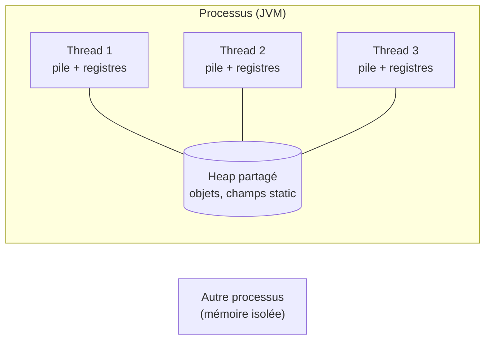

| | Processus | Thread |
|---|---|---|
| Mémoire | Isolée | Partagée (heap) |
| Coût de création | Élevé | Moyen (thread OS), très faible (virtual thread) |
| Communication | IPC (sockets, fichiers, pipes) | Variables partagées |
| Crash | N'affecte pas les autres | Peut faire tomber tout le processus |

Le partage mémoire est à la fois la force (communication rapide) et le danger (accès concurrents) des threads.

### Créer et lancer un thread

```java
Thread t = new Thread(() -> System.out.println("Bonjour depuis " + Thread.currentThread().getName()));
t.start();   // crée un nouveau thread qui exécute run()
t.join();    // attend la fin de t
```

Piège classique : appeler `t.run()` au lieu de `t.start()` exécute le code dans le thread courant, sans créer de thread.

### Cycle de vie

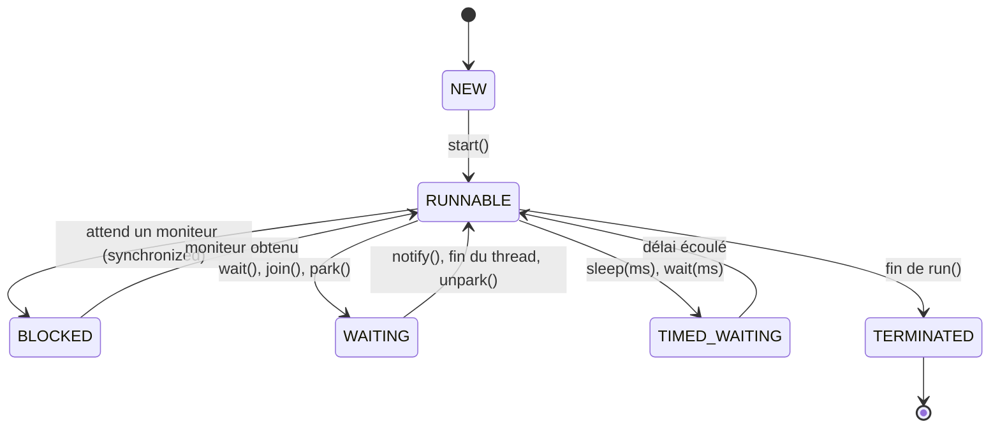

### Interruption

On n'arrête pas un thread de force (`Thread.stop()` a été retiré). On lui **demande** de s'arrêter avec `t.interrupt()`, et le thread vérifie `Thread.currentThread().isInterrupted()` ou reçoit une `InterruptedException` s'il est bloqué dans `sleep`, `wait` ou `join`.

```java
try {
    Thread.sleep(1000);
} catch (InterruptedException e) {
    Thread.currentThread().interrupt(); // on restaure le drapeau, on ne l'avale pas
    return;
}
```

**À retenir** : processus = mémoire isolée, threads = mémoire partagée. `start()` et non `run()`. L'arrêt est coopératif via `interrupt()`.

---

## 2. Race condition et deadlock

### Race condition

Une **race condition** survient quand le résultat dépend de l'ordre dans lequel les threads s'entrelacent sur une donnée partagée.

```java
class Compteur {
    private int valeur = 0;
    void incrementer() { valeur++; }  // PAS atomique
}
```

`valeur++` cache trois opérations : lire, ajouter 1, écrire. Deux threads peuvent lire la même valeur et écrire le même résultat : un incrément est perdu.

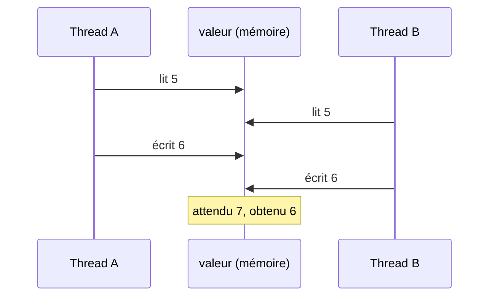

Les deux formes typiques :

- **read-modify-write** : `x++`, `x += n`.
- **check-then-act** : `if (!map.containsKey(k)) map.put(k, v);` (un autre thread peut insérer entre le test et l'action).

### Visibilité et `volatile`

Autre problème, plus sournois : sans synchronisation, un thread peut **ne jamais voir** une écriture faite par un autre (caches CPU, réordonnancements du compilateur). Le Java Memory Model définit la relation **happens-before** : une écriture est garantie visible si elle "arrive avant" la lecture, par exemple via la sortie d'un bloc `synchronized`, l'écriture d'une variable `volatile`, ou `Thread.start()` / `join()`.

```java
private volatile boolean running = true; // visible immédiatement par tous les threads
```

`volatile` garantit la **visibilité**, pas l'**atomicité** : `volatileInt++` reste une race condition.

### Deadlock

Un **deadlock** (interblocage) : deux threads ou plus s'attendent mutuellement et aucun ne peut avancer.

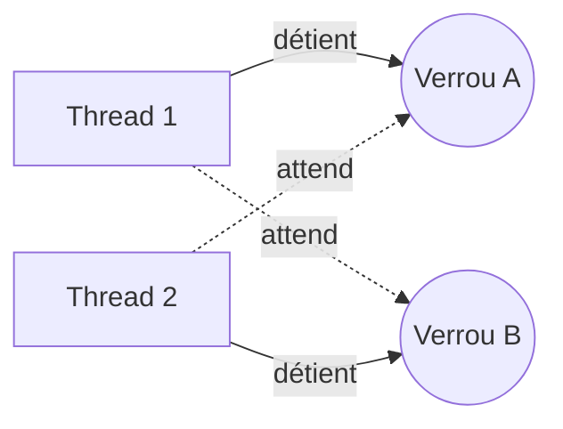

```java
// Thread 1                         // Thread 2
synchronized (a) {                  synchronized (b) {
    synchronized (b) { ... }            synchronized (a) { ... }
}                                   }
```

Les 4 conditions de Coffman, toutes nécessaires :

1. **Exclusion mutuelle** : la ressource n'est détenue que par un seul thread.
2. **Détention et attente** : on garde un verrou en attendant un autre.
3. **Pas de préemption** : on ne peut pas retirer un verrou à un thread.
4. **Attente circulaire** : T1 attend T2 qui attend T1.

Casser une seule condition suffit à éviter le deadlock.

### Cousins du deadlock

- **Livelock** : les threads ne sont pas bloqués mais réagissent sans fin l'un à l'autre (deux personnes qui s'écartent du même côté dans un couloir).
- **Starvation (famine)** : un thread n'obtient jamais la ressource parce que d'autres passent toujours avant.

### Bonnes pratiques

- Toujours acquérir les verrous **dans le même ordre global**.
- Utiliser `lock.tryLock(timeout)` pour abandonner au lieu d'attendre indéfiniment.
- Garder les sections critiques courtes, ne jamais appeler du code inconnu (callback) en tenant un verrou.
- Préférer les objets immuables : ce qui ne change pas n'a pas besoin d'être protégé.

**À retenir** : race condition = résultat dépendant de l'entrelacement ; deadlock = attente circulaire. `volatile` = visibilité seulement.

---

## 3. Synchronisation

Vue d'ensemble des outils, du plus bas niveau au plus haut :

| Outil | Rôle | Bloquant ? |
|---|---|---|
| `synchronized` | Exclusion mutuelle + visibilité | Oui |
| `volatile` | Visibilité seulement | Non |
| `ReentrantLock` | Comme `synchronized`, avec `tryLock`, timeout, équité | Oui |
| `Atomic*` | Opérations atomiques sans verrou (CAS) | Non |
| `Semaphore` | Limiter à N accès simultanés | Oui |
| `CountDownLatch` | Attendre que N événements aient eu lieu (usage unique) | Oui |
| `CyclicBarrier` | N threads s'attendent à un point de rendez-vous (réutilisable) | Oui |

### `synchronized`

Chaque objet Java possède un **moniteur** (verrou intrinsèque). Un seul thread à la fois peut le détenir.

```java
class Compteur {
    private int valeur;
    public synchronized void incrementer() { valeur++; } // verrouille this
    public synchronized int get() { return valeur; }      // la lecture aussi doit être synchronisée
}
```

- Méthode d'instance `synchronized` : verrou sur `this`.
- Méthode `static synchronized` : verrou sur l'objet `Class`.
- Bloc `synchronized (obj) { ... }` : verrou sur `obj`. Préférer un verrou privé (`private final Object lock = new Object();`) pour qu'aucun code extérieur ne puisse le prendre.
- Le verrou est **réentrant** : un thread qui le détient peut le reprendre.
- `wait()` / `notify()` / `notifyAll()` permettent d'attendre une condition, toujours dans une boucle `while` et dans un bloc `synchronized` sur le même objet.

### `ReentrantLock`

```java
private final ReentrantLock lock = new ReentrantLock();

void transfert() {
    lock.lock();
    try {
        // section critique
    } finally {
        lock.unlock(); // toujours dans finally
    }
}
```

Avantages : `tryLock()`, `tryLock(timeout)`, `lockInterruptibly()`, plusieurs `Condition`, mode équitable (`new ReentrantLock(true)`).

### Sémaphore

Un `Semaphore` gère un nombre de **permis**. `acquire()` en prend un (ou attend), `release()` le rend.

```java
Semaphore connexions = new Semaphore(3); // au plus 3 accès simultanés à la base

void requete() throws InterruptedException {
    connexions.acquire();
    try {
        // appel à la base
    } finally {
        connexions.release();
    }
}
```

Usage typique : limiter la charge sur une ressource externe (API, base de données). Très utile avec les virtual threads, qu'on ne limite plus par la taille d'un pool.

### Variables atomiques

`AtomicInteger`, `AtomicLong`, `AtomicReference`, `LongAdder`... reposent sur l'instruction processeur **CAS** (compare-and-swap) : "si la valeur vaut encore X, remplace-la par Y, sinon réessaie".

```java
AtomicInteger compteur = new AtomicInteger();
compteur.incrementAndGet();              // atomique, sans verrou
compteur.updateAndGet(v -> v * 2);       // fonction appliquée de façon atomique
```

`LongAdder` est plus performant qu'`AtomicLong` pour un compteur très sollicité en écriture (il répartit les incréments sur plusieurs cellules).

### CyclicBarrier vs CountDownLatch

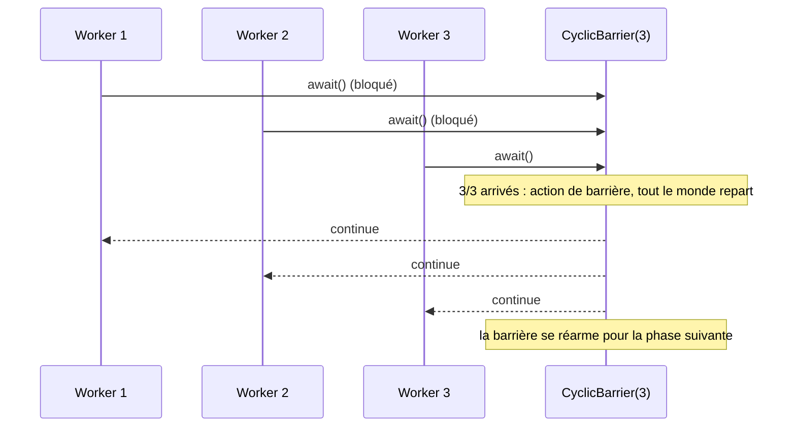

```java
CyclicBarrier barriere = new CyclicBarrier(3, () -> System.out.println("Phase terminée"));
// chaque worker, à la fin d'une phase de calcul :
barriere.await();
```

| | CountDownLatch | CyclicBarrier |
|---|---|---|
| Qui attend ? | Un ou plusieurs threads attendent que d'autres fassent `countDown()` | Les N participants s'attendent entre eux |
| Réutilisable | Non | Oui (cyclique) |
| Exemple | Le main attend que 5 services aient démarré | Simulation en phases synchronisées |

**À retenir** : `synchronized` pour le cas simple, `ReentrantLock` pour plus de contrôle, `Atomic*` pour un compteur, `Semaphore` pour limiter, barrière/latch pour coordonner.

---

## 4. Pool de threads et ExecutorService

### Pourquoi un pool ?

Créer un thread OS par tâche coûte cher et peut épuiser la machine. Un **pool** garde un nombre fixe de threads qui piochent les tâches dans une file.

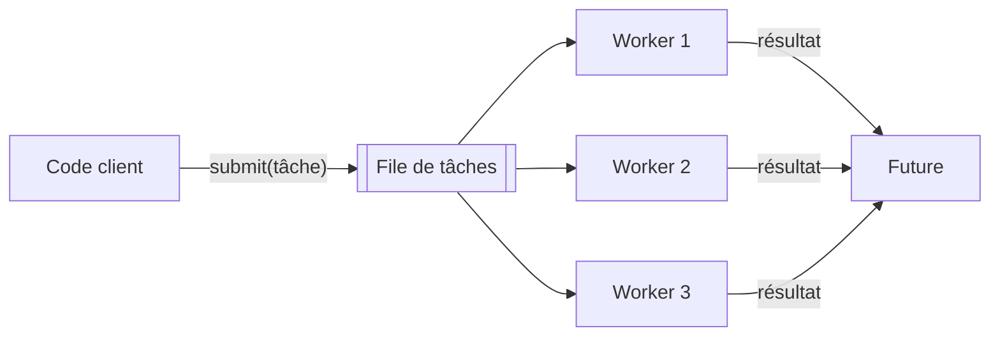

### Utilisation

```java
try (ExecutorService pool = Executors.newFixedThreadPool(4)) { // ExecutorService est AutoCloseable depuis Java 19
    Future<Integer> f = pool.submit(() -> calculLong());
    Integer resultat = f.get();          // bloque jusqu'au résultat
}                                        // close() = shutdown() + attente de la fin des tâches
```

- `execute(Runnable)` : lance, pas de résultat.
- `submit(Callable)` : renvoie un `Future` (`get()`, `cancel()`, `isDone()`).
- `invokeAll(tâches)` / `invokeAny(tâches)` : toutes / la première qui réussit.

### Arrêt

| Méthode | Effet |
|---|---|
| `shutdown()` | Refuse les nouvelles tâches, termine celles en cours et en file |
| `shutdownNow()` | Interrompt les tâches en cours, renvoie celles en file |
| `awaitTermination(délai)` | Bloque jusqu'à la fin ou au délai |
| `close()` | `shutdown()` puis attente (try-with-resources) |

Un pool non arrêté empêche la JVM de se terminer (ses threads ne sont pas daemon).

### Les fabriques d'`Executors`

| Fabrique | Usage |
|---|---|
| `newFixedThreadPool(n)` | n threads fixes, file non bornée |
| `newCachedThreadPool()` | Crée des threads à la demande, les recycle |
| `newSingleThreadExecutor()` | Un seul thread : exécution séquentielle garantie |
| `newScheduledThreadPool(n)` | Tâches différées ou périodiques |
| `newWorkStealingPool()` | `ForkJoinPool` : calcul parallèle récursif |
| `newVirtualThreadPerTaskExecutor()` | Un virtual thread par tâche (Java 21+) |

En production, on configure souvent `ThreadPoolExecutor` directement : `corePoolSize`, `maximumPoolSize`, une **file bornée** et une **politique de rejet** (`CallerRunsPolicy`, `AbortPolicy`...), pour éviter qu'une file non bornée n'absorbe la mémoire.

### CompletableFuture en deux lignes

```java
CompletableFuture.supplyAsync(() -> chargerClient(id), pool)
    .thenApply(Client::nom)
    .thenAccept(System.out::println);
```

Permet de chaîner des traitements asynchrones sans bloquer. Puissant mais vite illisible ; les virtual threads permettent souvent de revenir à du code bloquant simple.

### Dimensionnement (threads de plateforme)

- Tâches **CPU-bound** : environ le nombre de cœurs (`Runtime.getRuntime().availableProcessors()`).
- Tâches **I/O-bound** : plus de threads, car ils passent leur temps à attendre. C'est exactement le cas que les virtual threads résolvent.

**À retenir** : un pool réutilise les threads, `submit` renvoie un `Future`, toujours arrêter le pool (`close()` / `shutdown()`).

---

## 5. Collections thread-safe

Les collections classiques (`ArrayList`, `HashMap`) ne sont **pas** thread-safe : accès concurrents = données corrompues ou `ConcurrentModificationException`.

| Besoin | Collection | Principe |
|---|---|---|
| Map concurrente | `ConcurrentHashMap` | Verrous fins par case + CAS, lectures sans verrou |
| Map triée concurrente | `ConcurrentSkipListMap` | Skip list sans verrou |
| Liste lue souvent, modifiée rarement | `CopyOnWriteArrayList` | Copie le tableau à chaque écriture |
| File non bloquante | `ConcurrentLinkedQueue` | CAS |
| File bloquante | `ArrayBlockingQueue`, `LinkedBlockingQueue` | `put`/`take` bloquants |
| Anciennes solutions | `Vector`, `Hashtable`, `Collections.synchronizedList(...)` | Un verrou global : correct mais lent |

### Les opérations composées

Une collection thread-safe protège chaque opération, **pas la séquence de deux opérations**.

```java
// FAUX : check-then-act, race condition même avec une ConcurrentHashMap
if (!map.containsKey(cle)) map.put(cle, valeur);

// JUSTE : opérations atomiques fournies par ConcurrentHashMap
map.putIfAbsent(cle, valeur);
map.computeIfAbsent(cle, k -> charger(k));
map.merge(mot, 1, Integer::sum);          // compteur de mots
```

### Bonnes pratiques

- `ConcurrentHashMap` par défaut pour une map partagée ; elle refuse les clés et valeurs `null`.
- `CopyOnWriteArrayList` seulement si les écritures sont rares (listeners, configuration).
- Les itérateurs des collections concurrentes sont *weakly consistent* : pas d'exception, mais ils peuvent ne pas voir les modifications récentes.
- Les collections immuables (`List.of`, `Map.copyOf`) sont thread-safe par nature.

**À retenir** : `ConcurrentHashMap` + méthodes atomiques (`merge`, `computeIfAbsent`), jamais de check-then-act.

---

## 6. Producteur / consommateur

### Le problème

Des **producteurs** créent des éléments, des **consommateurs** les traitent, à des rythmes différents. Il faut une zone tampon partagée qui :

- bloque le producteur quand elle est pleine,
- bloque le consommateur quand elle est vide.

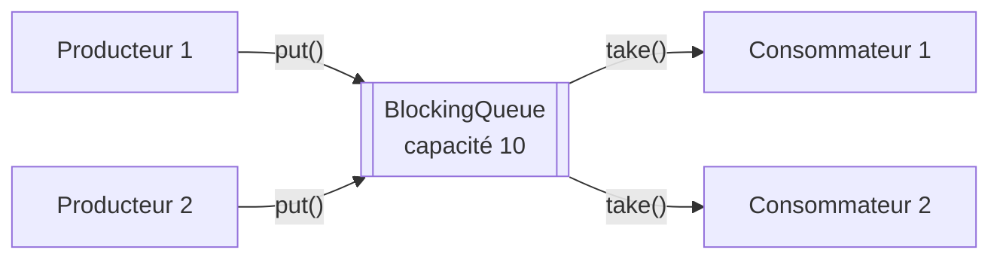

### Solution moderne : `BlockingQueue`

```java
BlockingQueue<Commande> file = new ArrayBlockingQueue<>(10); // bornée : contre-pression
Commande FIN = new Commande(-1);                              // "poison pill"

Runnable producteur = () -> {
    try {
        for (int i = 0; i < 100; i++) file.put(new Commande(i)); // bloque si pleine
        file.put(FIN);
    } catch (InterruptedException e) { Thread.currentThread().interrupt(); }
};

Runnable consommateur = () -> {
    try {
        while (true) {
            Commande c = file.take();                            // bloque si vide
            if (c == FIN) break;
            traiter(c);
        }
    } catch (InterruptedException e) { Thread.currentThread().interrupt(); }
};
```

| Méthode | File pleine / vide |
|---|---|
| `put` / `take` | Bloque |
| `offer` / `poll` | Renvoie `false` / `null` immédiatement |
| `offer(e, délai)` / `poll(délai)` | Attend au plus le délai |

### Version "à la main" (pour comprendre)

Avant `java.util.concurrent`, on écrivait le tampon avec `synchronized`, `wait()` et `notifyAll()` :

```java
synchronized void put(T e) throws InterruptedException {
    while (file.size() == capacite) wait();   // while, pas if (réveils intempestifs)
    file.add(e);
    notifyAll();
}
```

### Bonnes pratiques

- Toujours une file **bornée** : une file infinie masque un consommateur trop lent jusqu'à l'`OutOfMemoryError`.
- Arrêt propre : poison pill (un par consommateur) ou interruption.
- Avec les virtual threads, on peut aussi supprimer la file : un virtual thread par élément, et un `Semaphore` pour limiter la charge.

**À retenir** : `BlockingQueue` bornée + `put`/`take` + poison pill.

---

## 7. Lecteurs / rédacteurs (ReaderWriter)

### Le problème

Beaucoup de threads lisent une donnée, quelques-uns l'écrivent. Un verrou exclusif sérialise inutilement les lectures. On veut :

- **plusieurs lecteurs en même temps**,
- **un seul rédacteur**, et aucun lecteur pendant qu'il écrit.

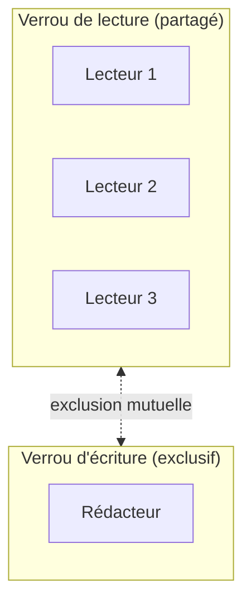

### `ReentrantReadWriteLock`

```java
class Cache<K, V> {
    private final Map<K, V> map = new HashMap<>();
    private final ReadWriteLock rw = new ReentrantReadWriteLock();

    V get(K k) {
        rw.readLock().lock();
        try { return map.get(k); }
        finally { rw.readLock().unlock(); }
    }

    void put(K k, V v) {
        rw.writeLock().lock();
        try { map.put(k, v); }
        finally { rw.writeLock().unlock(); }
    }
}
```

- On peut **rétrograder** (prendre le verrou de lecture en tenant celui d'écriture, puis relâcher l'écriture), mais pas **promouvoir** une lecture en écriture : deadlock.
- Mode équitable (`new ReentrantReadWriteLock(true)`) pour éviter la famine des rédacteurs.

### `StampedLock` (Java 8+)

Ajoute la **lecture optimiste** : on lit sans verrou, puis on vérifie qu'aucune écriture n'a eu lieu entre-temps.

```java
long stamp = sl.tryOptimisticRead();
double x = this.x, y = this.y;
if (!sl.validate(stamp)) {            // une écriture a eu lieu : on relit sous verrou
    stamp = sl.readLock();
    try { x = this.x; y = this.y; } finally { sl.unlockRead(stamp); }
}
```

Plus rapide quand les écritures sont rares, mais non réentrant et plus délicat.

**À retenir** : lecteurs en parallèle, rédacteur seul. `ReentrantReadWriteLock` d'abord, `StampedLock` si la performance l'exige. Pour une simple map, `ConcurrentHashMap` suffit souvent.

---

# Partie 2 : virtual threads

## 8. Principes fondateurs

### Le constat

Dans le modèle "un thread par requête", un serveur qui traite 10 000 requêtes concurrentes, chacune attendant une base de données, a besoin de 10 000 threads OS. C'est trop lourd. La réponse historique était la programmation **réactive / asynchrone** (callbacks, `CompletableFuture`, Reactor), efficace mais difficile à écrire, lire et déboguer.

Les virtual threads (projet Loom, **finalisés en Java 21**, JEP 444) gardent le style simple et bloquant, en rendant le blocage presque gratuit.

### Modèle M:N

Beaucoup (M) de virtual threads sont exécutés par peu (N) de threads OS, appelés **carrier threads**, organisés dans un `ForkJoinPool` dédié (autant de carriers que de cœurs par défaut).

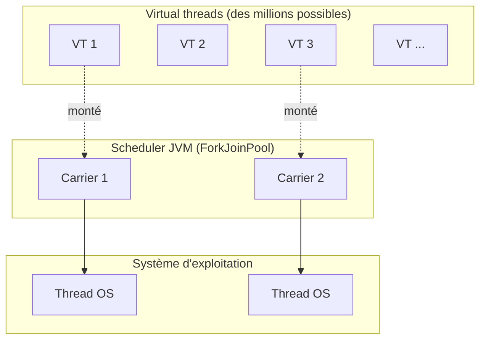

### Montage et démontage

Quand un virtual thread fait une opération bloquante (I/O réseau, `sleep`, `BlockingQueue.take`, `lock()`...), la JVM le **démonte** : sa pile est copiée dans le heap et le carrier part exécuter un autre virtual thread. Quand l'opération est prête, le virtual thread est **remonté** sur un carrier, pas forcément le même.

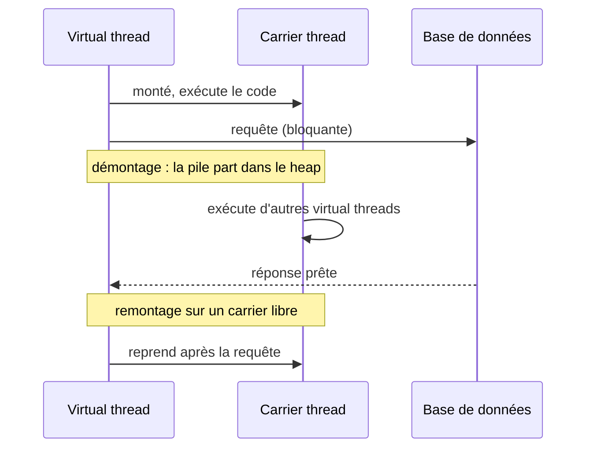

### Ce que ça change, et ce que ça ne change pas

| | Thread de plateforme | Virtual thread |
|---|---|---|
| Géré par | OS | JVM |
| Coût mémoire | ~1 Mo de pile réservée | Quelques centaines d'octets, pile dans le heap |
| Nombre raisonnable | Milliers | Millions |
| Pool ? | Oui | Non, un par tâche |
| Toujours daemon | Non | Oui |
| Priorité modifiable | Oui | Non (ignorée) |

Les virtual threads rendent l'attente bon marché, **pas le calcul plus rapide**. Ils améliorent le **débit** (nombre de tâches simultanées), pas la latence d'une tâche isolée. Pour du calcul CPU pur, ils n'apportent rien.

**À retenir** : M virtual threads sur N carriers ; un appel bloquant libère le carrier ; idéal pour beaucoup de tâches I/O-bound.

---

## 9. API de création

Un virtual thread est un `java.lang.Thread` : toute l'API existante (`join`, `interrupt`, `ThreadLocal`...) fonctionne.

```java
// 1. Démarrage direct
Thread vt = Thread.startVirtualThread(() -> traiter());

// 2. Builder (nommage, démarrage différé)
Thread vt2 = Thread.ofVirtual().name("worker-", 0).start(() -> traiter()); // worker-0
Thread pasDemarre = Thread.ofVirtual().unstarted(() -> traiter());

// 3. Fabrique de threads (pour les bibliothèques qui attendent une ThreadFactory)
ThreadFactory factory = Thread.ofVirtual().name("vt-", 0).factory();

// 4. ExecutorService : la façon la plus courante
try (ExecutorService executor = Executors.newVirtualThreadPerTaskExecutor()) {
    for (int i = 0; i < 10_000; i++) {
        int id = i;
        executor.submit(() -> appelerApi(id));
    }
} // close() attend la fin des 10 000 tâches

// Test
boolean v = Thread.currentThread().isVirtual();
```

Pour comparaison, le builder des threads classiques : `Thread.ofPlatform().name("p").start(...)`.

### Exemple parlant

```java
try (var executor = Executors.newVirtualThreadPerTaskExecutor()) {
    IntStream.range(0, 100_000).forEach(i ->
        executor.submit(() -> { Thread.sleep(Duration.ofSeconds(1)); return i; }));
}
// Environ 1 seconde au total. Avec un pool fixe de 200 threads : environ 500 secondes.
```

### Bonnes pratiques

- `newVirtualThreadPerTaskExecutor()` ne réutilise rien : il crée un nouveau virtual thread par tâche, c'est voulu.
- Pour limiter la concurrence (quota d'API, connexions), utiliser un `Semaphore`, pas la taille d'un pool.
- Dans Spring Boot 3.2+, `spring.threads.virtual.enabled=true` fait traiter les requêtes par des virtual threads.

**À retenir** : `Thread.ofVirtual()`, `Thread.startVirtualThread()`, `Executors.newVirtualThreadPerTaskExecutor()`.

---

## 10. Structured Concurrency

> API en **preview** (JEP 505 en Java 25, toujours en preview en Java 26) : compiler et lancer avec `--enable-preview`. L'API a changé entre Java 21-24 (`new StructuredTaskScope.ShutdownOnFailure()`) et Java 25 (`StructuredTaskScope.open()`). Les exemples ci-dessous suivent Java 25.

### Le problème

Avec un `ExecutorService`, des sous-tâches lancées ensemble ne sont liées par rien :

```java
Future<User>  user  = executor.submit(() -> findUser(id));
Future<Order> order = executor.submit(() -> fetchOrder(id));
User u = user.get();   // si findUser échoue, fetchOrder continue pour rien
Order o = order.get(); // si le thread parent est interrompu, les sous-tâches ne le sont pas
```

On risque des **fuites** de tâches, du travail inutile et des erreurs difficiles à suivre.

### Le principe

La concurrence structurée applique au parallélisme la règle des blocs de code : **une sous-tâche ne survit pas au bloc qui l'a lancée**. Les sous-tâches forment une unité : le scope attend toutes ses sous-tâches, et si l'une échoue, les autres sont annulées.

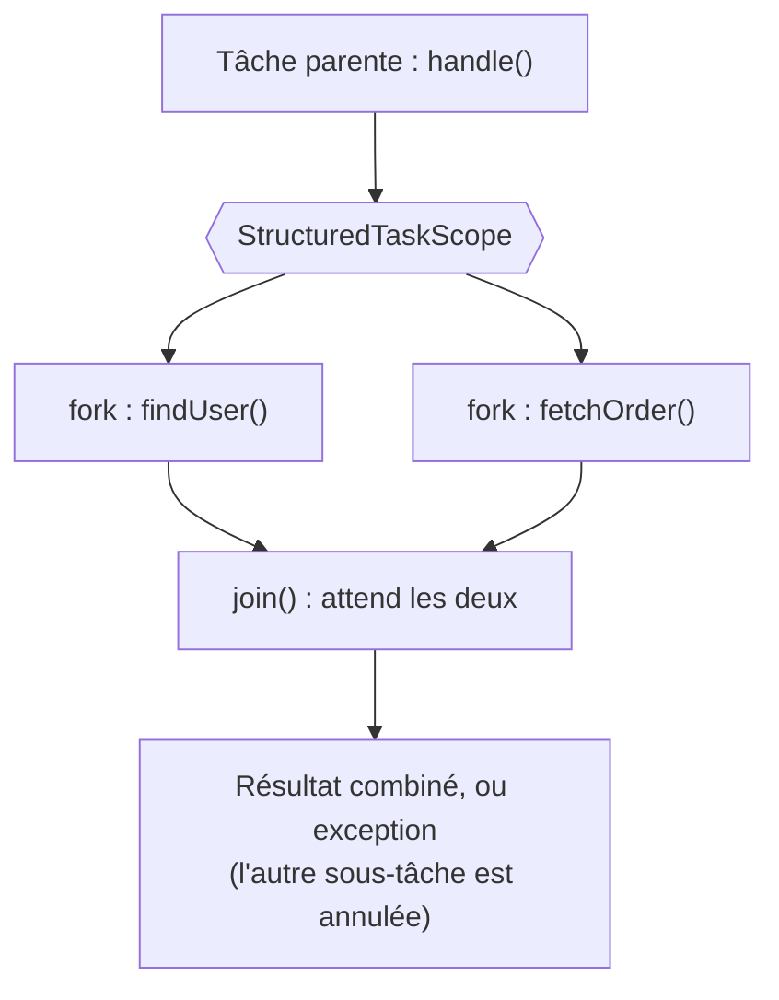

### Exemple (Java 25, preview)

```java
Response handle(String id) throws InterruptedException {
    try (var scope = StructuredTaskScope.open()) {      // politique par défaut : tout doit réussir
        Subtask<User>  user  = scope.fork(() -> findUser(id));
        Subtask<Order> order = scope.fork(() -> fetchOrder(id));

        scope.join();   // attend ; si une sous-tâche échoue, annule l'autre et lève FailedException

        return new Response(user.get(), order.get());
    }                   // à la sortie du try, aucune sous-tâche ne tourne encore
}
```

D'autres politiques s'obtiennent avec un `Joiner` passé à `open(...)`, par exemple "le premier qui réussit gagne" (interroger plusieurs serveurs miroirs).

### Avantages

- **Pas de fuite** : impossible de sortir du bloc avec une sous-tâche en cours.
- **Annulation propagée** : échec d'une sous-tâche ou interruption du parent, tout s'arrête.
- **Observabilité** : les thread dumps montrent la hiérarchie parent/sous-tâches.
- Chaque `fork` crée un virtual thread par défaut.

**À retenir** : `open()` / `fork()` / `join()` dans un try-with-resources ; les sous-tâches vivent et meurent avec leur scope.

---

## 11. ScopedValue vs ThreadLocal

### `ThreadLocal` : le rappel

Un `ThreadLocal` donne à chaque thread sa propre copie d'une variable. Usage typique : transporter un contexte (utilisateur connecté, transaction, id de corrélation) sans le passer en paramètre partout.

```java
static final ThreadLocal<User> CURRENT_USER = new ThreadLocal<>();

CURRENT_USER.set(user);
try {
    service.traiter();          // lit CURRENT_USER.get() n'importe où plus bas
} finally {
    CURRENT_USER.remove();      // à ne jamais oublier dans un pool
}
```

Ses défauts :

- **Mutable** : n'importe quel code peut appeler `set()`, le flux de données devient difficile à suivre.
- **Durée de vie illimitée** : oublier `remove()` provoque des fuites mémoire et des fuites de données entre requêtes dans un pool.
- **Coûteux à hériter** : `InheritableThreadLocal` copie les valeurs dans chaque thread enfant. Avec des millions de virtual threads, l'empreinte mémoire explose.

### `ScopedValue` : l'alternative

**Finalisée en Java 25** (JEP 506). Une `ScopedValue` est liée à une valeur **immuable** pour la durée d'un appel, puis disparaît automatiquement.

```java
static final ScopedValue<User> CURRENT_USER = ScopedValue.newInstance();

ScopedValue.where(CURRENT_USER, user).run(() -> service.traiter());
// dans traiter() ou plus bas : CURRENT_USER.get()
// après run() : plus de liaison, rien à nettoyer
```

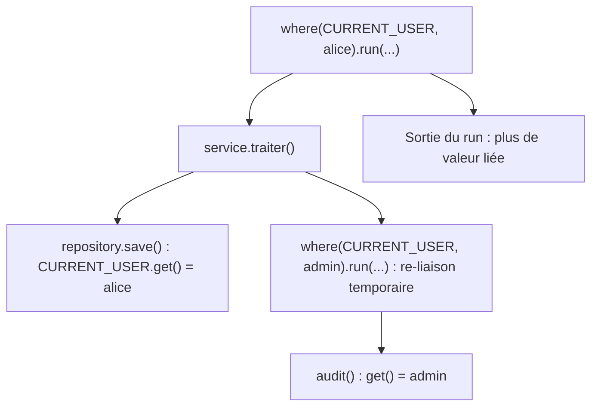

| | ThreadLocal | ScopedValue |
|---|---|---|
| Mutabilité | `set()` à tout moment | Immuable, re-liaison seulement dans un sous-scope |
| Durée de vie | Jusqu'au `remove()` ou la fin du thread | Exactement la durée de `run()` / `call()` |
| Nettoyage | Manuel | Automatique |
| Héritage | `InheritableThreadLocal`, par copie | Partagé sans copie avec les sous-tâches d'un `StructuredTaskScope` |
| Coût avec des millions de threads | Élevé | Faible |

### Bonnes pratiques

- Nouveau code et contexte en lecture seule : `ScopedValue`.
- `ThreadLocal` reste utile pour un cache **par thread de plateforme** (ex. un `SimpleDateFormat` non thread-safe), mais pas avec des virtual threads : chaque virtual thread aurait sa copie, donc aucun partage.

**À retenir** : `ScopedValue` = immuable, bornée à une portée, nettoyée automatiquement, adaptée aux virtual threads.

---

## 12. Anti-patterns à connaître

### 1. Mettre des virtual threads dans un pool

```java
// MAUVAIS : on recrée la limite qu'on voulait supprimer
ExecutorService pool = Executors.newFixedThreadPool(100, Thread.ofVirtual().factory());

// BON
ExecutorService executor = Executors.newVirtualThreadPerTaskExecutor();
```

Un virtual thread est jetable : on en crée un par tâche. Pour limiter la concurrence, on utilise un `Semaphore`.

### 2. Le pinning

Un virtual thread est **épinglé** (*pinned*) quand il ne peut pas se démonter de son carrier pendant un blocage : le carrier est alors bloqué lui aussi. Avec seulement N carriers, quelques threads épinglés suffisent à bloquer toute l'application.

Causes :

- Bloquer à l'intérieur d'un bloc `synchronized` : **jusqu'à Java 23**. Corrigé en **Java 24** (JEP 491) : les virtual threads se démontent désormais dans `synchronized`.
- Bloquer pendant un appel de code natif (JNI) ou de fonction étrangère : toujours d'actualité.

Sur Java 21 : remplacer `synchronized` autour d'une I/O par un `ReentrantLock`.

```java
// Java 21 : épingle le carrier pendant l'appel réseau
synchronized (lock) { client.send(request); }

// Java 21 : pas d'épinglage
lock.lock();
try { client.send(request); } finally { lock.unlock(); }
```

### 3. Utiliser des virtual threads pour du calcul CPU

Du calcul pur ne bloque jamais, donc ne libère jamais le carrier : aucun gain, et ça prive les autres virtual threads de carriers. Pour le calcul : un pool de threads de plateforme dimensionné au nombre de cœurs, ou les streams parallèles.

### 4. Gros objets dans des `ThreadLocal`

Un cache coûteux dans un `ThreadLocal` était partagé par les 200 threads d'un pool. Avec un virtual thread par requête, il est recréé à chaque requête : explosion mémoire et aucune réutilisation.

### 5. Ne pas limiter les ressources en aval

Les virtual threads lèvent la limite côté application, mais la base de données a toujours un pool de 50 connexions et l'API partenaire un quota. Sans `Semaphore` ou pool de connexions, on les inonde.

### 6. Attendre un gain de latence

Une requête seule ne va pas plus vite. Le gain porte sur le nombre de requêtes traitées en parallèle.

**À retenir** : pas de pool de virtual threads, attention au pinning (`synchronized` avant Java 24, code natif), pas de calcul CPU, pas de `ThreadLocal` lourd, limiter l'aval avec un `Semaphore`.

---

## 13. Monitoring

### Thread dumps

`jstack` montre mal les virtual threads (ils ne sont pas tous suivis). Utiliser le nouveau format :

```bash
jcmd <pid> Thread.dump_to_file -format=json dump.json   # ou -format=text
```

Le dump JSON regroupe les virtual threads par conteneur (executor, `StructuredTaskScope`), ce qui rend la hiérarchie lisible.

### JDK Flight Recorder (JFR)

```bash
java -XX:StartFlightRecording=filename=app.jfr,settings=profile -jar app.jar
jfr print --events jdk.VirtualThreadPinned app.jfr
```

| Événement JFR | Signale | Activé par défaut |
|---|---|---|
| `jdk.VirtualThreadPinned` | Un virtual thread bloqué en restant épinglé (> 20 ms) | Oui |
| `jdk.VirtualThreadSubmitFailed` | Échec de démarrage ou de reprise d'un virtual thread | Oui |
| `jdk.VirtualThreadStart` / `jdk.VirtualThreadEnd` | Création / fin | Non (trop volumineux) |

Avant Java 24, l'option `-Djdk.tracePinnedThreads=full` affichait une pile à chaque épinglage ; elle a été retirée en Java 24.

### Réglages du scheduler

```bash
-Djdk.virtualThreadScheduler.parallelism=8       # nombre de carriers (défaut : nombre de cœurs)
-Djdk.virtualThreadScheduler.maxPoolSize=256     # carriers supplémentaires temporaires (compensation)
```

### Ce qu'on surveille en pratique

- Les événements de **pinning** (JFR) : le premier suspect quand le débit s'effondre.
- La saturation des ressources en aval (pool de connexions, temps d'attente).
- La mémoire du heap : les piles des virtual threads y vivent.
- Les métriques des frameworks (Micrometer, Spring Boot Actuator) pour les executors.

**À retenir** : `jcmd Thread.dump_to_file`, JFR `jdk.VirtualThreadPinned`, `jdk.virtualThreadScheduler.parallelism`.

---

## 14. Concepts pour les entretiens

Questions fréquentes et réponses courtes :

**Thread vs processus ?**
Le processus a sa mémoire isolée ; les threads d'un processus partagent le heap et ont chacun leur pile.

**`synchronized` vs `ReentrantLock` ?**
Même sémantique. `ReentrantLock` ajoute `tryLock`, timeout, interruption, équité et plusieurs conditions, mais exige `unlock()` dans un `finally`.

**`volatile` suffit-il pour un compteur ?**
Non : il garantit la visibilité, pas l'atomicité de `x++`. Utiliser `AtomicInteger` ou `LongAdder`.

**Comment éviter un deadlock ?**
Ordre global d'acquisition des verrous, `tryLock` avec timeout, sections critiques courtes.

**`CountDownLatch` vs `CyclicBarrier` ?**
Latch : à usage unique, des threads attendent que d'autres aient fini. Barrière : réutilisable, N threads s'attendent mutuellement.

**`shutdown()` vs `shutdownNow()` ?**
Le premier laisse finir les tâches, le second les interrompt.

**`HashMap` vs `ConcurrentHashMap` vs `Collections.synchronizedMap` ?**
Pas thread-safe / verrous fins et lectures sans verrou / un verrou global.

**Qu'est-ce qu'un virtual thread ?**
Un thread léger géré par la JVM, exécuté sur un carrier thread, qui libère son carrier quand il bloque. Final en Java 21.

**Les virtual threads sont-ils plus rapides ?**
Non. Ils augmentent le débit des applications I/O-bound, pas la vitesse d'un calcul.

**Faut-il un pool de virtual threads ?**
Non, un par tâche. On limite les ressources avec un `Semaphore`.

**Qu'est-ce que le pinning ?**
Un virtual thread qui bloque sans pouvoir se démonter, et bloque donc son carrier. Causes : `synchronized` (jusqu'à Java 23), code natif. Détection : JFR `jdk.VirtualThreadPinned`.

**Virtual threads vs programmation réactive ?**
Même objectif (beaucoup de concurrence avec peu de threads OS). Les virtual threads gardent un code séquentiel, lisible, avec des stack traces normales.

**Pourquoi `ScopedValue` plutôt que `ThreadLocal` ?**
Immuable, durée de vie bornée, nettoyage automatique, partage peu coûteux avec les sous-tâches, adapté à des millions de threads.

**Que résout la Structured Concurrency ?**
Les fuites de sous-tâches et l'annulation : les sous-tâches d'un scope se terminent avec lui, et l'échec de l'une annule les autres.

---

## Fiche de synthèse

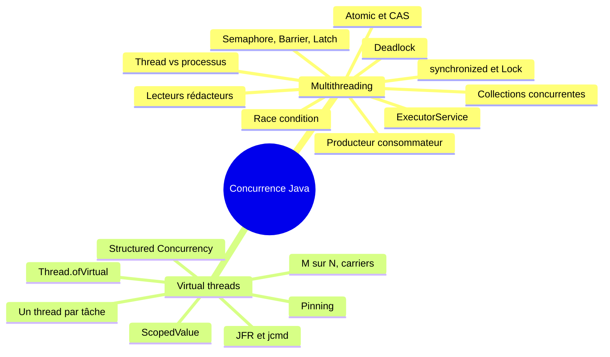

| Situation | Outil |
|---|---|
| Compteur partagé | `AtomicInteger` / `LongAdder` |
| Section critique simple | `synchronized` |
| Verrou avec timeout ou équité | `ReentrantLock` |
| Limiter à N accès simultanés | `Semaphore` |
| Attendre que N tâches soient finies | `CountDownLatch` |
| Rendez-vous de N threads par phases | `CyclicBarrier` |
| Map partagée | `ConcurrentHashMap` (+ `merge`, `computeIfAbsent`) |
| Échange producteur / consommateur | `BlockingQueue` bornée |
| Beaucoup de lectures, peu d'écritures | `ReentrantReadWriteLock` |
| Calcul CPU parallèle | Pool fixe de threads de plateforme, `ForkJoinPool` |
| Beaucoup de tâches I/O bloquantes | `Executors.newVirtualThreadPerTaskExecutor()` |
| Sous-tâches liées (tout ou rien) | `StructuredTaskScope` (preview) |
| Contexte de requête en lecture seule | `ScopedValue` |

### Repères de versions

| Version | Nouveauté |
|---|---|
| Java 5 | `java.util.concurrent` (executors, locks, atomics, collections concurrentes) |
| Java 7 | `ForkJoinPool` |
| Java 8 | `CompletableFuture`, `StampedLock`, `LongAdder` |
| Java 19 | `ExecutorService` devient `AutoCloseable` |
| Java 21 (LTS) | Virtual threads finaux ; Structured Concurrency et ScopedValue en preview |
| Java 24 | Plus de pinning dans `synchronized` (JEP 491) |
| Java 25 (LTS) | `ScopedValue` finale ; nouvelle API Structured Concurrency (`open()`, preview) |
